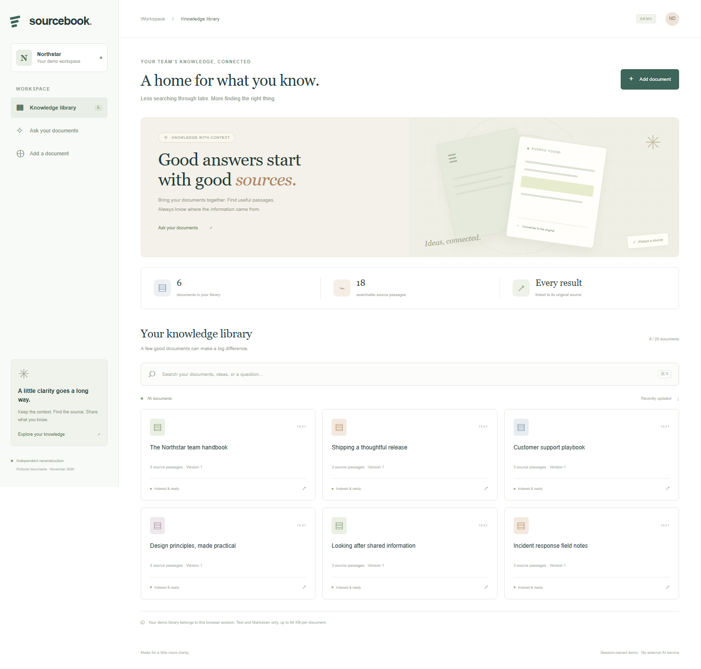

# Sourcebook

**Independent reconstruction, newly authored in November 2026.** Sourcebook is a small document library that answers a useful question: where did this information come from? It stores versioned text documents, searches their passages, and links every result back to an exact source version.

It is original demonstration code with fictional team documents. It is not an employer repository, a recovered historical application, or proof that any person completed an assignment.



## Context and evidence

The supplied resume reports LET'S DO YOUR PLAN employment from **August 2023 to March 2026**. [Another developer's public portfolio](https://sonbt.dev/) and [CV](https://sonbt.dev/Son_Banh_CV_PHP.pdf) mention Laravel backend work for Racine.ai under LDYP. [Racine.ai's own company history](https://racine.ai/a-propos/) states it was created in June 2024 and describes its document-AI domain.

These sources establish a company-project lead, not the resume subject's participation or delivery dates. Sourcebook independently explores document knowledge workflows. Its stack and scope are its own; it does not claim to recreate Racine.ai's proprietary products, models, interface, or historical implementation. Commits retain their actual new development dates.

## What works

- A separate knowledge workspace for each browser session, initially containing six fictional operational documents.
- Text or Markdown import through paste or upload, with UTF-8, extension, binary-content and 64 KB validation. Uploaded files are read as text and never executed.
- Versioned documents with optimistic conflict protection. A stale tab cannot overwrite a newer version.
- SQLite FTS5 passage search, ranked by text relevance, with safely parameterized and normalized query terms.
- An "Ask your documents" view that returns **unchanged, cited source excerpts**. It does not generate an AI answer, call a language model, or claim semantic understanding.
- Exact source-version links and safe search-term highlighting. Older source versions remain readable after updates.
- Atomic reindexing: failed saves roll back together, updates replace stale search entries, and deletion removes every source version and index entry.
- Responsive layouts, labeled forms, keyboard focus, honest empty states and bounded workspace/document/query sizes.

Search uses the latest document versions and returns at most twelve passages (four in question mode). It removes common English question words, uses two small documented alias groups (`response/respond` and `prepare/preparation/checklist`), and prioritizes matches covering all query concepts, then the first two, before broad individual-term matches. Sources that do not match the query produce a visible no-result state. This is an English-oriented keyword/Porter-stemmed retrieval demo, not a production RAG system or an AI model integration.

## Run locally

Requirements: PHP 8.5 recommended (8.4.1 minimum), Composer 2, SQLite with FTS5, and PDO SQLite, mbstring, intl, DOM/XML and fileinfo extensions. No JavaScript build or external service is required.

```sh
git clone https://github.com/hi676sweet/document-knowledge-reconstruction.git
cd document-knowledge-reconstruction
composer run setup
composer run dev
```

Open **http://127.0.0.1:8066**. Setup installs locked dependencies, creates the local environment/key and SQLite database, and runs migrations. Your fictional six-document library is created on first use; no login is required. Each session may store up to 25 documents. Losing the session loses access to that session's documents.

Try asking **"What is the support response time?"** or searching **"release rollback"**. Add a fictional `.txt` or `.md` file, edit it to create a second version, and follow the source history to compare them.

Imports normalize line endings and trim surrounding whitespace before saving. Markdown is displayed as plain text, including any HTML markup. SQLite keeps FTS temporary work in memory so the bounded demo also works in restricted Windows environments. The database and application files remain on disk.

## Validate

```sh
composer validate --strict
php artisan test --compact
vendor/bin/pint --test --cache-file=storage/framework/cache/pint-review.json
php artisan view:cache
```

Use a new Pint cache filename for an independent formatting check. Tests cover tenant/session isolation, invalid files, escaped content, query abuse, version-specific citations, index replacement/deletion, transactional rollback, stale edits, document limits, Unicode chunks, and a real disk-backed FTS bootstrap. GitHub Actions runs the same checks on pushes and pull requests.

To erase every local demo workspace and document, run `php artisan migrate:fresh`. This is destructive to local demo data.

## Implementation

Laravel 13, Livewire 4, Blade, original CSS artwork, and SQLite FTS5. Database triggers maintain the full-text index as source passages change. Document and version changes occur in one database transaction. Encrypted database sessions hold the workspace owner token; all document reads and writes enforce ownership on the server. Local databases, environment secrets, dependencies, caches and test artifacts are excluded from source control.

Session ownership is a demo access mechanism. A deployed product would need authenticated accounts, lifecycle/retention controls, resource quotas and operational monitoring appropriate to its use.

MIT licensed; see [LICENSE](LICENSE). Laravel skeleton attribution is preserved.
